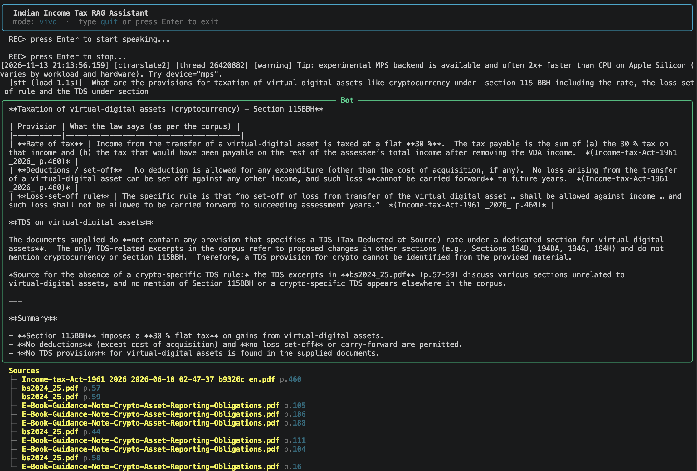
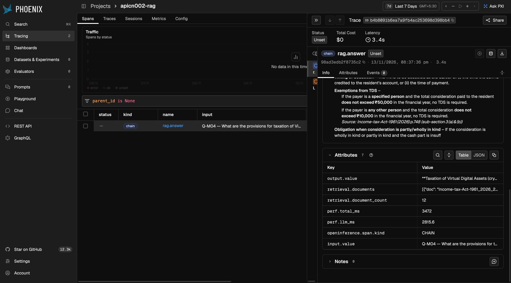
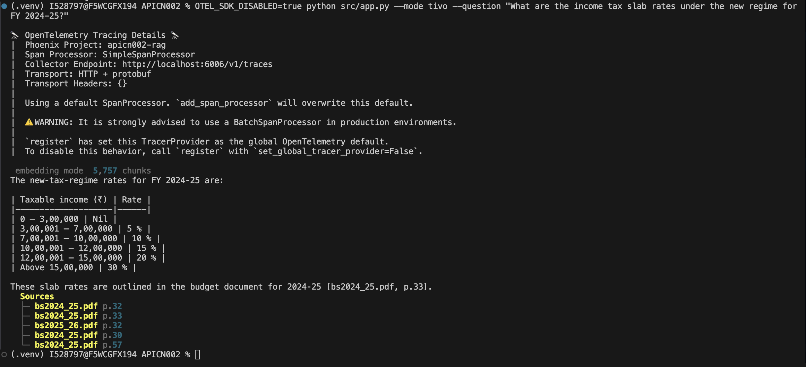
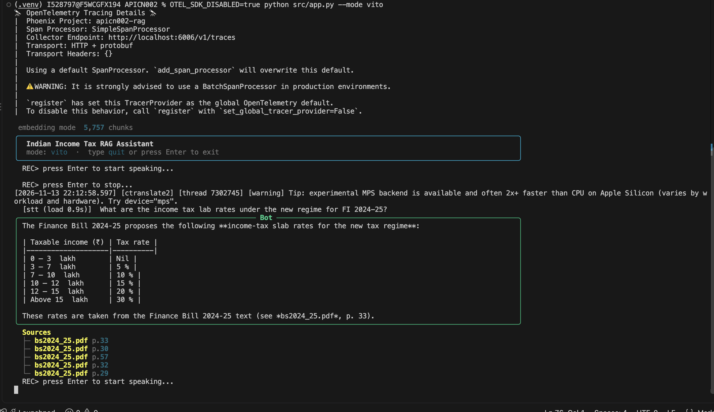

# Architecture — APICN002

## System Overview

RAG chatbot answering Indian Income Tax queries from official government documents. Supports TITO (text in, text out), TIVO (text in, voice out), VITO (voice in, text out), and VIVO (voice in, voice out).

## Ingestion Pipeline — `src/rag/ingest.py`

PDF extraction uses PyMuPDF with a pypdf fallback, one page at a time. Chunking: 900-character sliding window, 150-character overlap, word-boundary snapped. Each chunk stores source filename and page number. Embeddings via `nomic-embed-text:latest` (Ollama `/api/embed`, batch 32, up to 3 retries with exponential backoff). Index written atomically to `index/chunks.json` and `index/embeddings.npy`; count consistency validated at load.

## Retrieval — `src/rag/retriever.py`

Query embedded with `nomic-embed-text:latest`; cosine similarity over pre-normalised corpus embeddings via NumPy matrix multiply; top-k chunks returned with document and page metadata. Index integrity validated at load (count, NaN, dimension). Falls back to TF-IDF when `embeddings.npy` is absent.

## Answer Generation — `src/rag/llm.py`

Retrieved chunks assembled into a source-labelled context block. System prompt enforces eight domain rules covering progressive slabs, regime/residency separation, Section 112A equity LTCG, Section 194S VDA TDS, and 4% cess. Conversation history prepended for follow-up awareness. A deterministic tax calculator (`src/rag/tax_calc.py`) covering FY 2024-25 new and old regimes is triggered on computation queries; its output is appended to the LLM answer. Supported providers: Groq, OpenAI, Anthropic, OpenRouter, and Ollama (`slm`).




## Speech Components

**STT** (`src/speech/stt.py`): faster-whisper (local, default), Groq Whisper API, or OpenAI Whisper API. Model loaded once and reused. Temp WAV deleted after transcription.

**TTS** (`src/speech/tts.py`): pyttsx3 (default, offline); piper CLI and edge-tts as alternatives. Long answers split into sentence pairs before synthesis. Temp audio deleted after playback.

## Configuration

All parameters via `.env`: LLM provider/model/keys, embedding model/URL/batch, STT/TTS provider and model, chunk size, overlap, TOP_K.

## Observability — `src/tracing.py`

OpenTelemetry tracing exported to Arize Phoenix (`PHOENIX_COLLECTOR_ENDPOINT`). Two spans: `rag.answer` (retrieval + LLM) and `llm.chat`; both log inputs, outputs, and timing. No-op without `arize-phoenix-otel`.



## Demonstrating All Four Modes

### Prerequisites

All modes require Python 3.11+, `pip install -r requirements.txt`, a built index (`python src/rag/ingest.py`), and Ollama `nomic-embed-text:latest`.

**LLM (active):** `LLM_PROVIDER=groq`, `LLM_MODEL=openai/gpt-oss-120b`, `GROQ_API_KEY=<key>`. **Alternative:** `LLM_PROVIDER=slm`, `SLM_BASE_URL=http://localhost:11434/v1` (Ollama).

TIVO requires system audio output and `pyttsx3` (included in requirements). VITO/VIVO additionally require a working microphone and `pip install sounddevice soundfile`.

### Commands

From project root (`--mode` verified at `src/app.py:221`):

```bash
python src/app.py --mode tito                  # TITO (also the default)
python src/app.py --mode tivo                  # TIVO: type in → spoken answer
python src/app.py --mode tivo --question "What is the standard deduction for FY 2024-25?"
                                               # TIVO one-shot — no microphone needed
python src/app.py --mode vito                  # VITO: mic → typed answer
python src/app.py --mode vivo                  # VIVO: mic → spoken answer
```

VITO/VIVO recording: app prompts `REC> press Enter to start speaking`, then `REC> press Enter to stop`.





### Verification

| Mode | Code | Unit tests | Real LLM | Real audio |
|---|---|---|---|---|
| TITO | ✓ | ✓ mocked | ✓ Stage 9, 13 Qs (Groq) | n/a |
| TIVO | ✓ | ✓ TTS mocked | ✓ LLM path shared with TITO | ✓ screenshot (images/) |
| VITO | ✓ | ✓ STT + rec mocked | ✓ STT, Stage 10 (real files) | ✓ screenshot (images/) |
| VIVO | ✓ | ✓ each sub-path | ✓ STT, Stage 10 (real files) | ✓ screenshot (images/) |
